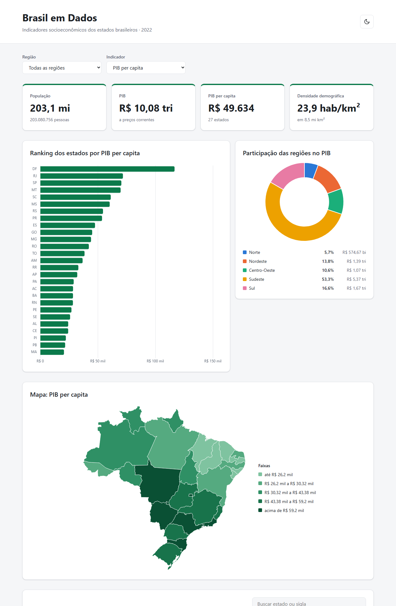

# 📊 Brasil em Dados

> Painel web interativo que consome dados abertos do IBGE e apresenta indicadores socioeconômicos dos estados brasileiros.

[](https://github.com/anxmarks/painel-ibge/actions/workflows/ci.yml)
[](https://github.com/anxmarks/painel-ibge/actions/workflows/deploy.yml)


🔗 **Demo:** [anxmarks.github.io/painel-ibge](https://anxmarks.github.io/painel-ibge/)

<picture>
  <source media="(prefers-color-scheme: dark)" srcset="docs/preview-dark.png" />
  
</picture>

---

## 📌 Sumário

- [Sobre o projeto](#-sobre-o-projeto)
- [Funcionalidades](#-funcionalidades)
- [Tecnologias](#-tecnologias)
- [Fonte de dados](#-fonte-de-dados)
- [Arquitetura](#-arquitetura)
- [Estrutura de pastas](#-estrutura-de-pastas)
- [Como executar](#-como-executar)
- [Qualidade e entrega contínua](#-qualidade-e-entrega-contínua)
- [Aprendizados](#-aprendizados)
- [Próximos passos](#-próximos-passos)
- [Autora](#-autora)

---

## 💡 Sobre o projeto

O **Brasil em Dados** transforma dados públicos do IBGE em visualizações claras e interativas. Dá para comparar estados, filtrar por região e explorar população, PIB, PIB per capita e densidade demográfica de 2022.

O painel foi feito **sem framework**, de propósito: o objetivo era dominar os fundamentos do JavaScript (DOM, módulos, estado, assincronismo) antes de partir para React.

---

## ✨ Funcionalidades

- **Cards de KPI** com população total, PIB total, PIB per capita e densidade demográfica da seleção
- **Ranking dos estados** em gráfico de barras, pelo indicador escolhido
- **Participação das regiões** (N, NE, CO, SE, S) em gráfico de rosca, com legenda que traz porcentagem e valor
- **Mapa coroplético** dos estados, em 5 faixas de cor, com nome e valor ao passar o mouse (ou tocar). Com uma região filtrada, os outros estados ficam cinza, como contexto
- **Série histórica** da participação de cada região no PIB, de 2002 a 2023, em gráfico de linha. A legenda mostra o primeiro e o último ano e a variação em pontos percentuais; com uma região filtrada, ela fica em destaque e as outras ficam cinza. Abaixo do gráfico, os valores de todos os anos ficam numa tabela (para leitores de tela ou para quem quer o número exato), que também pode ser exportada em CSV
- **Tabela ordenável** por qualquer coluna, com busca que ignora acentos
- **Filtros** por região e por indicador, que atualizam o painel inteiro
- **Estados de interface:** skeleton de carregamento, mensagem de erro com "Tentar novamente"
- **Cache local** das respostas da API (localStorage, expira em 24h)
- **Tema claro/escuro**, que segue o sistema até a pessoa escolher
- **Exportação em CSV** do que a tabela está mostrando, pronta para abrir no Excel em português
- **Responsivo e acessível:** testado em 360px, 768px e 1280px; navegação por teclado, link para pular ao conteúdo, `aria-label` nos gráficos, cores validadas para daltonismo

**Lighthouse:** Performance 96 no celular e 100 no desktop; 100 em Acessibilidade, Boas Práticas e SEO.

---

## 🛠 Tecnologias

| Categoria   | Ferramenta                                                                                      |
| ----------- | ----------------------------------------------------------------------------------------------- |
| Linguagem   | JavaScript (ES Modules)                                                                         |
| Build / Dev | [Vite](https://vitejs.dev/)                                                                     |
| Gráficos    | [Chart.js](https://www.chartjs.org/)                                                            |
| Mapa        | [d3-geo](https://d3js.org/d3-geo) (só a projeção; o desenho é SVG puro)                         |
| Estilo      | CSS moderno (variáveis, Grid, Flexbox)                                                          |
| Qualidade   | ESLint + Prettier                                                                               |
| Testes      | [Vitest](https://vitest.dev/) (unidade) e [Playwright](https://playwright.dev/) (ponta a ponta) |
| CI / Deploy | GitHub Actions + [GitHub Pages](https://pages.github.com/)                                      |

---

## 🗄 Fonte de dados

Os dados vêm da **[API de Serviço de Dados do IBGE](https://servicodados.ibge.gov.br/api/docs)**, pública, gratuita e sem autenticação.

| Dado                        | Endpoint                                                                                         |
| --------------------------- | ------------------------------------------------------------------------------------------------ |
| Estados e regiões           | `GET /api/v1/localidades/estados`                                                                |
| População residente (Censo) | `GET /api/v3/agregados/4709/periodos/2022/variaveis/93?localidades=N3[all]`                      |
| PIB a preços correntes      | `GET /api/v3/agregados/5938/periodos/2022/variaveis/37?localidades=N3[all]`                      |
| PIB, série histórica        | `GET /api/v3/agregados/5938/periodos/2002-2023/variaveis/37?localidades=N3[all]`                 |
| Área territorial (Censo)    | `GET /api/v3/agregados/4714/periodos/2022/variaveis/6318?localidades=N3[all]`                    |
| Contornos dos estados       | `GET /api/v3/malhas/paises/BR?formato=application/vnd.geo+json&intrarregiao=UF&qualidade=minima` |

Os indicadores são todos do **mesmo ano (2022)**, para que as divisões façam sentido; só a série histórica usa todos os anos do PIB. Dois indicadores são calculados no front-end:

- **PIB per capita** = `PIB ÷ população` (o PIB, que a API entrega em mil reais, é convertido para reais)
- **Densidade demográfica** = `população ÷ área`, em habitantes por km². O resultado bate com a densidade oficial do IBGE (variável 614), com diferença só no arredondamento.

Nos totais do Brasil e das regiões, as duas razões são calculadas sobre as somas (ex.: população total ÷ área total), e não como média dos estados, que daria o mesmo peso a Roraima e a São Paulo.

---

## 🏗 Arquitetura

O fluxo dos dados segue a ideia de um pipeline de ETL:

```
  API IBGE  ──►  services/  ──►  utils/transform  ──►  state  ──►  components/
  (Extract)      (fetch +        (Transform:           (store      (Load: gráficos,
                  cache)          normaliza, junta,     central)    cards, tabela)
                                  calcula per capita)
```

- **services/**: toda a comunicação com a API. Os componentes nunca chamam `fetch`.
- **utils/**: funções puras, sem efeitos colaterais, cobertas por testes.
- **state.js**: um store simples (`getState`, `setState`, `subscribe`). A interface é sempre `render(estado)`: um filtro muda o estado, e o painel se redesenha a partir dele.
- **components/**: cada parte da interface é criada uma vez e expõe um `update()`. Os gráficos são atualizados com `chart.update()`, nunca recriados.
- **config.js**: URLs, códigos de tabelas e todos os valores fixos. Nenhum "número mágico" solto no código.

---

## 📁 Estrutura de pastas

```
painel-ibge/
├── .github/workflows/
│   ├── ci.yml              # Prettier, ESLint, testes e build a cada push/PR
│   └── deploy.yml          # Publica no GitHub Pages a cada push na main
├── docs/                   # Imagens do README
├── public/                 # favicon e robots.txt
├── src/
│   ├── components/         # kpiCards, barChart, regionChart, stateMap, historyChart, historyTable, dataTable, filters, themeToggle, chartTheme
│   ├── services/           # ibgeApi (fetch) e cache (localStorage com expiração)
│   ├── utils/              # transform, format (Intl pt-BR), exportCsv, urlState e map (faixas do mapa)
│   ├── styles/             # variables.css (design tokens e tema escuro) e main.css
│   ├── config.js
│   ├── state.js
│   └── main.js             # Ponto de entrada
├── e2e/                    # Playwright: fluxos no navegador, com a API simulada por fixtures
├── tests/                  # Vitest: transform, format, cache, state, exportCsv, urlState, map, history
├── index.html
└── vite.config.js
```

---

## 🚀 Como executar

**Pré-requisitos:** Node.js 20.19+ e npm

```bash
git clone https://github.com/anxmarks/painel-ibge.git
cd painel-ibge
npm install
npm run dev
```

O painel abre em `http://localhost:5173/painel-ibge/` (o caminho `/painel-ibge/` é o mesmo do GitHub Pages).

| Script                 | Descrição                              |
| ---------------------- | -------------------------------------- |
| `npm run dev`          | Servidor local com hot reload          |
| `npm run build`        | Build otimizado em `dist/`             |
| `npm run preview`      | Pré-visualiza o build                  |
| `npm test`             | Testes com Vitest (modo watch)         |
| `npm run test:e2e`     | Testes de ponta a ponta com Playwright |
| `npm run lint`         | Analisa o código com ESLint            |
| `npm run format`       | Formata o código com Prettier          |
| `npm run format:check` | Confere a formatação sem alterar nada  |

---

## ✅ Qualidade e entrega contínua

- **116 testes de unidade** (Vitest) cobrem as funções puras: transformação dos dados do SIDRA, cálculo do per capita e da densidade, formatação, cache, store, filtros na URL, geração do CSV, as faixas e a geometria do mapa e a participação das regiões ano a ano.
- **Testes de ponta a ponta** (Playwright) abrem o build de produção num navegador de verdade, no desktop e no celular, e conferem os fluxos completos: filtros e URL, botão "voltar", busca, ordenação, download do CSV, mapa (faixas, filtro de região, caixinha no mouse e no toque), série histórica (valores, destaque da região, tabela e CSV), tema e erro com "Tentar novamente". A API do IBGE é simulada com respostas reais salvas em `e2e/fixtures/`, então os testes não dependem da rede.
- **CI:** cada push e cada Pull Request rodam Prettier, ESLint, testes de unidade, build e testes de ponta a ponta no GitHub Actions.
- **Deploy contínuo:** cada merge na `main` roda os testes de novo e, se passarem, publica o build no GitHub Pages.
- **Fluxo de trabalho:** cada etapa do projeto foi uma branch e um Pull Request próprios, com commits no padrão [Conventional Commits](https://www.conventionalcommits.org/pt-br/).

---

## 🧠 Aprendizados

**O formato aninhado do SIDRA.** A API de agregados não devolve uma lista simples de estados: o valor de cada estado fica dentro de `resultados → series → serie → ano`, e vem como **texto**, às vezes com códigos como `"-"` ou `"..."` no lugar de um número. Separei esse trabalho em funções puras (`parseSidraValue`, `parseAggregateSeries`, `mergeStateData`) e escrevi testes para cada uma. Assim, o resto do painel só enxerga um array limpo de estados.

**Cache com expiração.** Os dados do IBGE mudam raramente, então não faz sentido buscá-los a cada visita. As respostas ficam no `localStorage` com a data em que foram salvas e expiram em 24h. O prefixo da chave tem versão (`v1`), o que permite invalidar o cache antigo se o formato dos dados mudar. Todo acesso ao `localStorage` fica em `try/catch`, porque em aba anônima ou com armazenamento bloqueado ele pode lançar erro, e o painel precisa continuar funcionando sem cache.

**O Chart.js guarda as opções das escalas.** Ao implementar o tema escuro, os eixos dos gráficos continuavam com as cores do tema claro. Descobri que o Chart.js copia as opções de escala quando o gráfico é criado, então mudar os padrões globais depois não tem efeito. A solução foi reaplicar as cores das escalas a cada `update()`, lendo os valores atuais das variáveis CSS.

**Achar a causa real de um problema de layout.** O Lighthouse apontou um CLS (deslocamento de layout) de 0,258 no celular. A primeira tentativa, ajustar a altura das linhas, não mudou nada. Medindo de novo, vi que o deslocamento vinha dos cards de KPI, que só apareciam depois que o JavaScript carregava. Colocar o skeleton dos cards direto no HTML reservou o espaço desde a primeira pintura, e o CLS foi para 0.

**Interface como função do estado.** Com um store central e uma única função `render(estado)`, carregamento, erro, filtros e tema passaram a ser só valores no estado. Isso deixou fácil implementar o botão "Tentar novamente" e garantir que tudo na tela fica sempre consistente.

**Testes que não dependem da internet.** Nos testes de ponta a ponta, o Playwright intercepta as chamadas à API do IBGE e responde com dados reais salvos no repositório. Assim os testes são rápidos, dão sempre o mesmo resultado e ainda permitem simular a API fora do ar para testar a tela de erro. Para confirmar que os testes realmente protegem o código, desliguei de propósito a sincronização com a URL e vi o teste falhar.

**Um mapa que não engana.** Mapa coroplético tem armadilhas, e eu quis evitar as principais:

- **Taxas, não totais.** Num mapa de população, os estados grandes parecem importantes só pelo tamanho. Por isso, quando o indicador escolhido é um total (população ou PIB), o mapa mostra a taxa correspondente (densidade ou PIB per capita) e avisa o motivo.
- **Faixas por quantis.** A densidade vai de 2,5 (Amazonas) a 489 hab/km² (DF). Com faixas de tamanho igual, quase todos os estados cairiam na primeira. Com quantis, cada faixa tem cerca de 5 estados. As faixas são calculadas sempre com os 27 estados, então filtrar uma região não muda a cor de ninguém.
- **Cores validadas.** Uma escala de um tom só (o verde do painel, e não o azul, que já significa "Norte" na rosca), conferida com um script: claridade sempre crescente e a faixa mais clara com pelo menos 2:1 de contraste com o fundo, nos dois temas.
- **O sentido dos polígonos.** O primeiro desenho saiu errado porque o GeoJSON do IBGE segue o padrão RFC 7946 (anti-horário), e o d3-geo, que calcula numa esfera, lê esse sentido como "o globo inteiro menos o estado". A solução foi uma função pura, com teste, que inverte os anéis quando a área passa de meia esfera.

Os testes de ponta a ponta pegaram um bug que eu não teria visto no computador: no celular, o navegador dispara `pointerleave` assim que o dedo sai da tela, e a caixinha do estado sumia na hora do toque. E o Lighthouse mostrou que desenhar os contornos travava a página por mais tempo; separar o primeiro desenho numa tarefa própria e reduzir a precisão dos caminhos do SVG levou a nota de 93 para 96.

**Uma série histórica honesta.** O PIB da API está a preços correntes. Em reais, de 2002 a 2023 todas as linhas subiriam juntas, e a maior parte da subida seria inflação, não crescimento. Por isso o gráfico mostra a **participação de cada região no PIB do Brasil** em cada ano: a inflação afeta o numerador e o divisor do mesmo jeito, e a comparação fica justa. O cálculo é uma função pura, com teste, que soma os estados de cada região e divide pelo total do ano. A história aparece: o Sudeste caiu de 57,4% para 53,0% e o Centro-Oeste foi o que mais ganhou (+2,0 p.p.). Para não virar um emaranhado de 27 linhas, o gráfico é por região, e o filtro destaca uma delas em vez de esconder as outras.

**Uma arquitetura que aguenta crescer.** Para testar se a separação em camadas funcionava de verdade, adicionei a densidade demográfica depois que o painel já estava pronto. Foram cerca de 90 linhas de código de produção, cada uma no seu lugar: o código da tabela do SIDRA no `config.js`, uma busca a mais no `services/`, uma função pura no `transform.js`, um formatador e um card. O gráfico de barras, os filtros, a URL e a ordenação da tabela passaram a funcionar com o indicador novo sem mudar nada. No caminho, um teste revelou que a função `formatInteger` não arredondava, um bug antigo que só apareceu com um dado novo.

**O que eu faria diferente:** usaria TypeScript desde o início para descrever o formato dos dados da API, e escreveria os testes de ponta a ponta junto com cada funcionalidade, em vez de no fim.

---

## 🔮 Próximos passos

- [ ] Série histórica por estado, além da série por região
- [ ] Novos indicadores (IDH, escolaridade, saneamento)
- [ ] Versão em React + TypeScript

---

## 👩‍💻 Autora

**Ana Luiza Marks** · Bacharel em Ciência da Computação (URI)

[](https://github.com/anxmarks)

---

## 📄 Licença

Distribuído sob a licença MIT. Veja [`LICENSE`](./LICENSE) para mais detalhes.

Dados: © IBGE — Instituto Brasileiro de Geografia e Estatística, disponibilizados via API pública.
